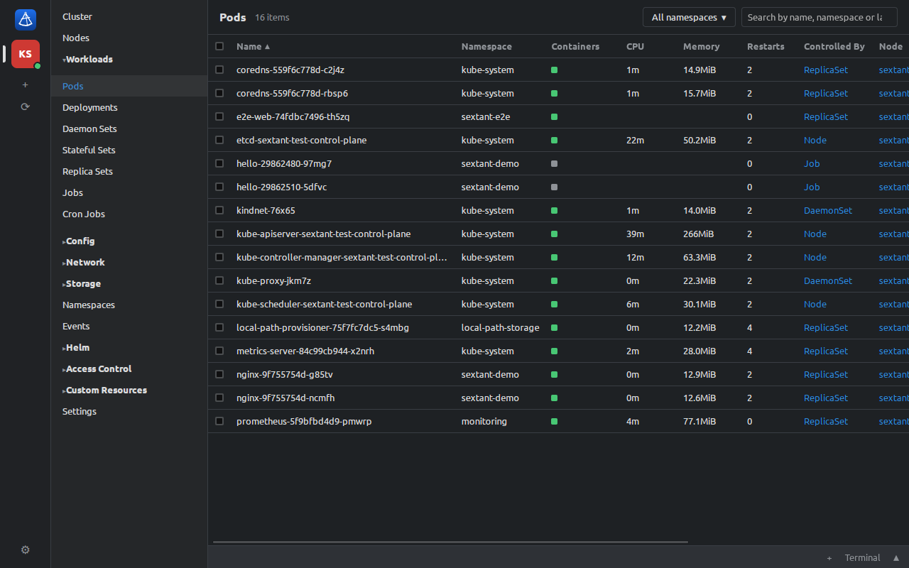

# Sextant

[](https://github.com/FriendsOfKubernetes/sextant/actions/workflows/ci.yml)
[](https://github.com/FriendsOfKubernetes/sextant/releases/latest)
[](#license)

Sextant is a desktop application for managing Kubernetes clusters — an alternative to Lens, written in Rust on
[Tauri 2](https://tauri.app). It reads your kubeconfig, shows the resources of every cluster in live tables and
lets you inspect, edit and operate them in one window. Linux, macOS and Windows.



## Features

- **Clusters from your kubeconfig** — `KUBECONFIG` (every file in the list) or `~/.kube/config`, plus files you add
  or paste. Every context is an entry in the cluster rail, with its own name and color; several clusters can be
  connected at once. Client certificates, tokens, basic auth and exec plugins are supported.
- **The Lens layout** — cluster rail, section tree, live resource table, details panel and a dock with tabs.
  Light, dark or system theme. Narrow windows (down to 360 px) move the rail and sidebar into a menu.
- **Every resource** — Workloads, Config, Network, Storage, Namespaces, Events, Access Control, Nodes and Custom
  Resources (columns from `additionalPrinterColumns`). Tables update through watches, handle thousands of rows,
  sort by any column and filter by namespace, name or label (`app=web`).
- **Details** — metadata, kind-specific fields, conditions, events and YAML; Secret values only on request; links
  between owners, pods, nodes, services and volumes.
- **Changes** — edit YAML (with conflict detection), create resources from multi-document YAML (server-side apply),
  delete, scale, rollout restart, cordon/uncordon and drain nodes, trigger and suspend CronJobs.
- **Logs** — follow, timestamps, previous container, search with highlighting, save to a file.
- **Shells** — a terminal in any container (`bash`, then `sh`) and a local terminal whose `kubectl` already points at
  the selected cluster.
- **Port forwarding** — from a pod or a service, to a chosen or a free local port; open it in the browser.
- **Metrics** — CPU and memory from metrics-server in tables and details; last-hour charts from Prometheus
  (found automatically or set per cluster).
- **Helm** — releases with values, manifest, notes and history are read straight from the cluster; upgrade,
  roll back, uninstall and install charts from your repositories through the `helm` binary.

The interface is in English; every string comes from translation files (`src/locales/<lang>/`), so adding a
language is adding a directory. There is no account, no server and no telemetry: settings stay in your OS config
folder.

## Installing

Download the installer for your system from the
[latest release](https://github.com/FriendsOfKubernetes/sextant/releases/latest):

| System | File |
|---|---|
| Linux (Debian, Ubuntu) | `Sextant_<version>_amd64.deb` — `sudo apt install ./Sextant_<version>_amd64.deb` |
| Linux (any distribution) | `Sextant_<version>_amd64.AppImage` — `chmod +x` it and run |
| macOS (Apple silicon and Intel) | `Sextant_<version>_universal.dmg` |
| Windows | `Sextant_<version>_x64_en-US.msi` |

### Unsigned installers

The installers are not code-signed, so the operating system warns the first time you open Sextant.

- **macOS:** move Sextant to Applications, then right-click it and choose **Open** (once). If macOS says the app
  "is damaged" or still refuses to open it, run `xattr -dr com.apple.quarantine /Applications/Sextant.app`.
- **Windows:** SmartScreen shows "Windows protected your PC" — choose **More info → Run anyway**.

Optional tools used by some features: `kubectl` (in the local terminal) and [`helm`](https://helm.sh/docs/intro/install/)
(installing and changing Helm releases; viewing releases works without it). If `helm` is not in `PATH`, choose the
binary in **Settings** (the gear at the bottom of the cluster rail).

### Updates

Sextant 0.2.0 and later update themselves. When Sextant starts it looks at the
[latest release](https://github.com/FriendsOfKubernetes/sextant/releases/latest) (turn this off in
**Settings → Updates**, where **Check for updates** also checks on demand and the running version is shown). A newer
release is offered with its notes; **Install and restart** downloads it, verifies its signature against the key
built into Sextant and restarts into the new version.

| Installed from | How it updates |
|---|---|
| AppImage (Linux) | in place, by Sextant |
| `.dmg` (macOS) | in place, by Sextant |
| `.msi` (Windows) | by Sextant: the installer runs and starts the new version |
| `.deb` (Linux) | with the package manager: download the new `.deb` and `sudo apt install ./Sextant_<version>_amd64.deb` (Sextant shows the new version and links the release page) |

Updates come only from releases signed with the project's updater key. A copy that is not an installed package
(`npm run tauri dev`, a bare binary) does not check at start and cannot install an update, but **Check for updates**
still shows whether there is one; a build whose `src-tauri/tauri.conf.json` has no `plugins.updater.pubkey` does
not check at all and says so in Settings.

## Roadmap

The plan lives in [GitHub Issues](https://github.com/FriendsOfKubernetes/sextant/issues), one issue per bug or
improvement:

- [**v0.2.0**](https://github.com/FriendsOfKubernetes/sextant/milestone/1) — fixes and improvements after 0.1.0:
  Secret values on request only, a terminal that targets the right cluster, no lost stream output, timeouts and
  retries, settings that are never lost, partial permissions, drain like `kubectl drain`, faster first load, YAML
  color schemes, in-app updates.
- [**Later**](https://github.com/FriendsOfKubernetes/sextant/milestone/2) — larger pieces for separate releases:
  a mobile version, cloud cluster sign-in, a shell on a node, code-signed installers, live testing on macOS and
  Windows.

## Building from source

Requirements:

- Rust (stable, 1.90 or newer) — <https://rustup.rs>
- Node.js 22+ with npm
- The Tauri system dependencies for your OS — <https://tauri.app/start/prerequisites/>
  (on Debian/Ubuntu: `libwebkit2gtk-4.1-dev`, `libgtk-3-dev`, `libayatana-appindicator3-dev`, `librsvg2-dev`,
  `build-essential`, `curl`, `wget`, `file`, `libssl-dev`, `libxdo-dev`)

```sh
git clone https://github.com/FriendsOfKubernetes/sextant.git
cd sextant
npm install
npm run tauri dev      # run in development mode
npm run tauri build    # build installers into target/release/bundle/
```

On Linux `npm run tauri build` produces `.deb`, `.rpm` and `.AppImage` packages; on macOS `.app`/`.dmg`; on Windows
`.msi` and an NSIS installer.

## Development

```sh
npm run check        # everything: rustfmt, clippy, cargo tests, TS bindings, tsc, eslint, vitest
npm run gen:types    # regenerate src/api/generated from the Rust types (ts-rs)
npx vitest run src/layout     # one group of frontend tests
cargo test -p sextant-core    # core unit tests
```

| Path | What |
|---|---|
| `crates/sextant-core` | Everything about clusters (kube-rs). No Tauri dependency, so it can back a mobile app later. |
| `src-tauri` | The desktop application (crate `sextant`): Tauri commands, events, local terminal. |
| `src` | The interface: React + TypeScript + Vite. `src/api` is the only bridge to the backend. |
| `src/locales/<lang>/<namespace>.json` | Translations. A new language is a new directory. |
| `scripts/test-cluster.sh` | A local kind cluster with test fixtures for development and tests. |
| `e2e/` | End-to-end tests of the whole window (WebdriverIO + tauri-driver). |

### Test cluster

Integration tests of the core run against a local [kind](https://kind.sigs.k8s.io) cluster and are skipped when
`SEXTANT_TEST_KUBECONFIG` is not set.

```sh
scripts/test-cluster.sh up --prometheus    # kind cluster "sextant-test" + metrics-server + Prometheus + fixtures
scripts/test-cluster.sh kubeconfig         # path to its admin kubeconfig
scripts/test-cluster.sh kubeconfig limited # kubeconfig of a ServiceAccount that cannot read Secrets
SEXTANT_TEST_KUBECONFIG=$(scripts/test-cluster.sh kubeconfig) \
  cargo test --workspace --tests -- --test-threads=1
scripts/test-cluster.sh down
```

The script keeps your `~/.kube/config` untouched; its files live in `~/.cache/sextant-test`.

### End-to-end tests

`npm run e2e` builds the debug app, starts it through [`tauri-driver`](https://v2.tauri.app/develop/tests/webdriver/)
and walks through every feature against `sextant-test`: connecting, the pod table, details, logs, a shell, YAML
editing, scaling, port forwarding, a Helm release, the overview, Settings and the narrow layout. It also takes the
screenshot above (`docs/screenshot.png`).

```sh
cargo install tauri-driver --locked
sudo apt install webkit2gtk-driver   # Linux: WebKitWebDriver
scripts/test-cluster.sh up --prometheus
npm run e2e
```

The app runs with throwaway config and data directories and only the test cluster's kubeconfig; everything the
tests create lives in the namespace `sextant-e2e`, which is deleted afterwards. A failed scenario leaves a
screenshot in `target/e2e/`. `SEXTANT_E2E_SKIP_BUILD=1` reuses the last build.

### Releases

The version lives in `Cargo.toml` (`[workspace.package]`), `src-tauri/tauri.conf.json` and `package.json` (plus
both lock files); `npm run check` fails when they differ (`node scripts/check-version.mjs`). Pushing a tag `v*`
equal to that version (for example `v0.2.0`) runs [`release.yml`](.github/workflows/release.yml): it refuses a tag
that does not match, builds the installers for the three systems, signs the update bundles and publishes them with
`latest.json` for the in-app updater as a GitHub Release. Signing needs the repository secrets
`TAURI_SIGNING_PRIVATE_KEY` and `TAURI_SIGNING_PRIVATE_KEY_PASSWORD` (the private half of the key whose public half
is `plugins.updater.pubkey`); a local `npm run tauri build` without them fails at signing — build with
`npm run tauri -- build --no-bundle`, or pass `--config '{"bundle":{"createUpdaterArtifacts":false}}'`. Every push
and pull request to `main` runs [`ci.yml`](.github/workflows/ci.yml) (`npm run check` on Linux, macOS and Windows).

## License

Licensed under either of

- Apache License, Version 2.0 ([LICENSE-APACHE](LICENSE-APACHE))
- MIT license ([LICENSE-MIT](LICENSE-MIT))

at your option.

Unless you explicitly state otherwise, any contribution intentionally submitted for inclusion in the work by you,
as defined in the Apache-2.0 license, shall be dual licensed as above, without any additional terms or conditions.
