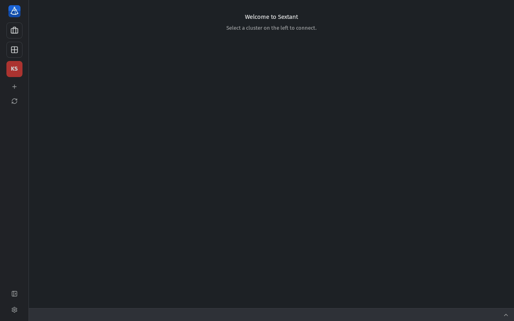
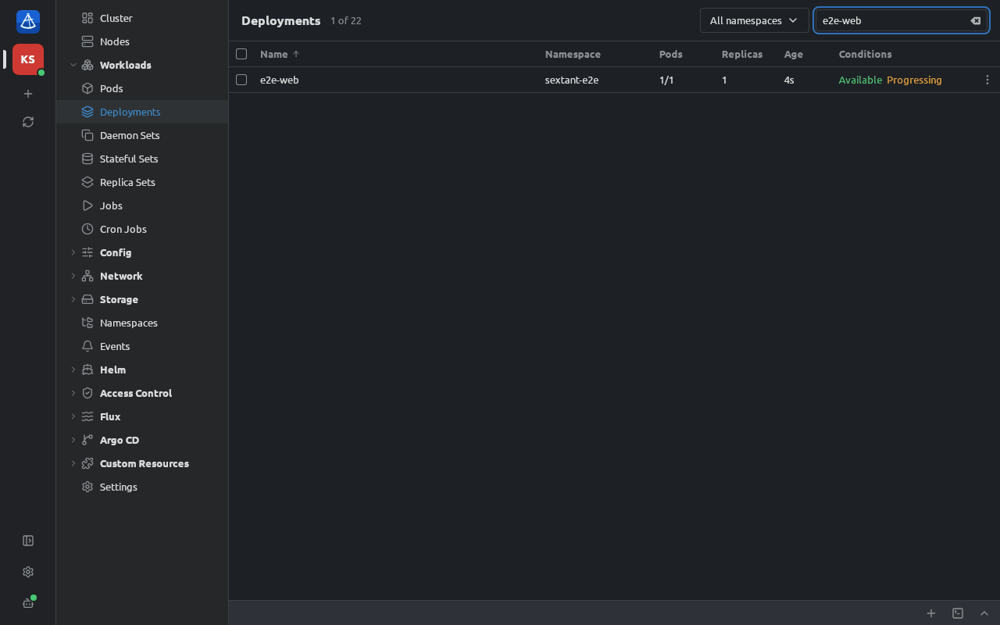

# Sextant

[](https://github.com/FriendsOfKubernetes/sextant/actions/workflows/ci.yml)
[](https://github.com/FriendsOfKubernetes/sextant/releases/latest)
[](https://github.com/FriendsOfKubernetes/sextant/releases)
[](#license)

Sextant is a desktop application for managing Kubernetes clusters — an alternative to Lens, written in Rust on
[Tauri 2](https://tauri.app). It reads your kubeconfig, shows the resources of every cluster in live tables and
lets you inspect, edit and operate them in one window. Linux, macOS and Windows.



## Features

- **Your kubeconfig** — every context is a cluster; several can be connected at once.
- **Cloud clusters** — find your Amazon EKS, Google GKE and Azure AKS clusters through the `aws`, `gcloud` and `az`
  you already use, and add them in a few clicks.
- **Every resource** in live tables, with details, a YAML editor, scale, restart, cordon, drain and CronJob actions;
  **custom columns** from labels, annotations and field paths, and **Set image…** with a preview and a patch of the
  image fields only.
- **Logs, shells and port forwarding** — container logs with search, logs of several pods at once, a shell in any
  container, debug containers, copying files to and from containers, a shell on a node (a temporary privileged pod,
  removed when you close it), a local terminal already pointed at the cluster.
- **Problems and notifications** — everything wrong in a cluster on one page, and desktop notifications for new
  problems that you can turn off globally, per kind of problem, per cluster or for an hour.
- **Command palette** (Ctrl+K) to jump to any object or page; **rollout history** with a diff and rollback.
- **Understand the cluster** — right-sizing of requests and limits from real usage, cert-manager and the expiry of every
  TLS certificate, a map of how objects relate (and what a delete would break), RBAC: who can do what.
- **Safer changes** — a dry run and a diff before applying YAML or upgrading a Helm release, upgrade readiness
  (deprecated and removed APIs, version skew), security posture (Pod Security Standards, Trivy reports), and an
  overview of several clusters.
- **Troubleshooting** — a timeline of what changed and by whom, why autoscaling did or did not scale, a cleanup of
  objects that are provably unused, and a network policy check: can pod A reach pod B.
- **Your workspace** — saved views of tables, pinned objects, workspaces of clusters, export and import to share
  them with your team (never credentials), and kubeconfig management: rename, duplicate, delete and merge contexts
  with a preview and a backup, and credential expiry.
- **Power tools** — a YAML editor that knows the cluster's schema (completion, validation, Explain), storage
  insights (volume usage, snapshots, Velero), a cost view from OpenCost or Kubecost, and terminal panes with snippets.
- **Scale and reach** — Istio and Linkerd views with request routing and who may call a workload, comparing objects
  and namespaces across clusters (and drift from Helm), comfortable on clusters with tens of thousands of pods, and
  keyboard and screen-reader friendly.
- **Faster diagnosis** — best-practice checks (probes, `:latest` images, single replicas, PodDisruptionBudgets,
  requests and limits) with a fix to copy, why a Service, Ingress or route gets no traffic, link by link, Helm revision
  compare and newer chart versions, and container probes in plain words.
- **Live traffic** — a workload's request rate, error rate and latency (p50/p95/p99) with CPU throttling and a hint
  when the CPU limit is the cause, and a live graph of who calls whom with the rate, errors and latency of each call,
  from what Istio, Linkerd, ingress-nginx, Grafana Beyla or Cilium Hubble already report to Prometheus or VictoriaMetrics — nothing
  installed.
- **Ecosystem** — Argo Rollouts (status, steps, weights, analysis; promote, abort and retry as the kubectl plugin
  sends them), Argo Workflows (the step tree with the failed step and its logs, CronWorkflows), Knative Serving,
  Crossplane (claim → composite → managed resources, paused state), Kyverno (policy results on every object),
  External Secrets (never the secret data), CloudNativePG (primary, replicas, backups, hibernation), Strimzi and
  Prometheus Operator (what a monitor selects and which Prometheus picks it up), each from the operator's own status.
- **In your language** — English, Russian, Ukrainian, German, French, Spanish, Portuguese (Brazil), Italian, Polish,
  Turkish, Chinese (Simplified and Traditional), Japanese and Korean.
- **Metrics** from metrics-server and Prometheus or VictoriaMetrics (both found automatically); **Helm** releases and charts; **Flux** and **Argo CD** (sync, diff).
- **MCP server for AI agents** — connect Claude Code, Claude Desktop or Cursor to your clusters, with permissions you
  set per cluster, confirmations in the window and an activity log; read-only diagnostic tools give agents the
  window's own answers (problems, traffic diagnosis, connectivity, permissions, recent changes, autoscaling), only
  from what the agent may read.
- No account, no server, no telemetry.

An AI agent asks to scale a deployment; Sextant asks you first and records the call:



## Install

Download the installer from the [latest release](https://github.com/FriendsOfKubernetes/sextant/releases/latest):

| System | Files |
|---|---|
| Linux x86_64 and arm64 | `.AppImage`, `.deb`, `.rpm` |
| macOS (Apple silicon and Intel) | universal `.dmg` |
| Windows x64 | `.msi`, or the portable `.zip` |

The installers are not code-signed, so macOS and Windows warn on first start — see
[Installation](https://github.com/FriendsOfKubernetes/sextant/wiki/Installation). The AppImage, `.dmg` and `.msi`
update themselves; `.deb`, `.rpm` and the portable `.zip` (Scoop's: `scoop update sextant`) are updated with your
package manager, and the app tells which when a new version is out.

Package managers:

```sh
brew install --cask friendsofkubernetes/sextant/sextant                 # macOS, Homebrew
scoop bucket add sextant https://github.com/FriendsOfKubernetes/sextant-scoop
scoop install sextant/sextant                                           # Windows, Scoop
```

winget (`winget install FriendsOfKubernetes.Sextant`) is coming soon.

## Documentation

The [wiki](https://github.com/FriendsOfKubernetes/sextant/wiki) describes everything:

- [Installation](https://github.com/FriendsOfKubernetes/sextant/wiki/Installation) — installers, unsigned builds, updates
- [Getting started](https://github.com/FriendsOfKubernetes/sextant/wiki/Getting-started) — kubeconfig, cloud clusters (EKS, GKE, AKS), connecting, the window
- [Using Sextant](https://github.com/FriendsOfKubernetes/sextant/wiki/Using-Sextant) — tables, YAML, logs, shells (containers and nodes), port forwarding, Helm, Flux, Argo CD
- [Problems and notifications](https://github.com/FriendsOfKubernetes/sextant/wiki/Problems-and-notifications) — a cluster's problems on one page, desktop notifications and how to turn them off
- [Right-sizing](https://github.com/FriendsOfKubernetes/sextant/wiki/Right-sizing), [cert-manager and certificates](https://github.com/FriendsOfKubernetes/sextant/wiki/cert-manager-and-certificates), [Resource map](https://github.com/FriendsOfKubernetes/sextant/wiki/Resource-map), [RBAC](https://github.com/FriendsOfKubernetes/sextant/wiki/RBAC)
- [Safe apply](https://github.com/FriendsOfKubernetes/sextant/wiki/Safe-apply), [Upgrade readiness](https://github.com/FriendsOfKubernetes/sextant/wiki/Upgrade-readiness), [Security posture](https://github.com/FriendsOfKubernetes/sextant/wiki/Security-posture), [All clusters](https://github.com/FriendsOfKubernetes/sextant/wiki/All-clusters)
- [Change timeline](https://github.com/FriendsOfKubernetes/sextant/wiki/Change-timeline), [Autoscaling](https://github.com/FriendsOfKubernetes/sextant/wiki/Autoscaling), [Cleanup](https://github.com/FriendsOfKubernetes/sextant/wiki/Cleanup), [Connectivity](https://github.com/FriendsOfKubernetes/sextant/wiki/Connectivity)
- [Best practices](https://github.com/FriendsOfKubernetes/sextant/wiki/Best-practices), [Traffic diagnosis](https://github.com/FriendsOfKubernetes/sextant/wiki/Traffic-diagnosis), [Request metrics and traffic](https://github.com/FriendsOfKubernetes/sextant/wiki/Request-metrics-and-traffic)
- [Views and workspaces](https://github.com/FriendsOfKubernetes/sextant/wiki/Views-and-workspaces), [Kubeconfig management](https://github.com/FriendsOfKubernetes/sextant/wiki/Kubeconfig-management)
- [YAML editor](https://github.com/FriendsOfKubernetes/sextant/wiki/YAML-editor), [Storage](https://github.com/FriendsOfKubernetes/sextant/wiki/Storage), [Cost](https://github.com/FriendsOfKubernetes/sextant/wiki/Cost), [Terminal](https://github.com/FriendsOfKubernetes/sextant/wiki/Terminal)
- [Service mesh](https://github.com/FriendsOfKubernetes/sextant/wiki/Service-mesh), [Compare](https://github.com/FriendsOfKubernetes/sextant/wiki/Compare), [Large clusters](https://github.com/FriendsOfKubernetes/sextant/wiki/Large-clusters), [Accessibility](https://github.com/FriendsOfKubernetes/sextant/wiki/Accessibility)
- [Argo Rollouts and Argo Workflows](https://github.com/FriendsOfKubernetes/sextant/wiki/Argo-Rollouts-and-Workflows), [Ecosystem views](https://github.com/FriendsOfKubernetes/sextant/wiki/Ecosystem-views) — Knative, Crossplane, Kyverno, External Secrets, CloudNativePG, Strimzi, Prometheus Operator
- [Custom columns](https://github.com/FriendsOfKubernetes/sextant/wiki/Custom-columns), [Set image](https://github.com/FriendsOfKubernetes/sextant/wiki/Set-image)
- [Gateway API](https://github.com/FriendsOfKubernetes/sextant/wiki/Gateway-API) — Gateways and routes with explained problems, topology, the request check and the hostname map
- [Installing Flux and Argo CD](https://github.com/FriendsOfKubernetes/sextant/wiki/Installing-Flux-and-Argo-CD) — from the app: sources and checks, rights, preview, removing them by hand
- [MCP server](https://github.com/FriendsOfKubernetes/sextant/wiki/MCP-server) — AI agents: setup, permissions, confirmations, security
- [Extensions](https://github.com/FriendsOfKubernetes/sextant/wiki/Extensions) and [Writing extensions](https://github.com/FriendsOfKubernetes/sextant/wiki/Writing-extensions) — your own pages, panels, actions and columns in isolated frames, with permissions you agree to; the SDK in `sdk/`
- [Settings](https://github.com/FriendsOfKubernetes/sextant/wiki/Settings) and [Troubleshooting](https://github.com/FriendsOfKubernetes/sextant/wiki/Troubleshooting)
- [Building from source](https://github.com/FriendsOfKubernetes/sextant/wiki/Building-from-source), [Development](https://github.com/FriendsOfKubernetes/sextant/wiki/Development) and [Translating](https://github.com/FriendsOfKubernetes/sextant/wiki/Translating) — the translations are machine-made; corrections from native speakers are welcome

## Community

Questions, ideas and projects go to [Discussions](https://github.com/FriendsOfKubernetes/sextant/discussions):
[Q&A](https://github.com/FriendsOfKubernetes/sextant/discussions/categories/q-a) for help,
[Ideas](https://github.com/FriendsOfKubernetes/sextant/discussions/categories/ideas) for suggestions,
[Show and tell](https://github.com/FriendsOfKubernetes/sextant/discussions/categories/show-and-tell) for what you built.
Found a bug? [Open an issue](https://github.com/FriendsOfKubernetes/sextant/issues/new/choose).

Articles about Sextant (in Russian, on Habr): [a Lens replacement written entirely by a model](https://habr.com/ru/articles/1095984/)
and [two roadmaps in two days: what is new in 0.12–0.19](https://habr.com/ru/articles/1097014/).

## Roadmap

What we plan for the next releases. Each release is a [milestone](https://github.com/FriendsOfKubernetes/sextant/milestones)
with one issue per feature; plans can change, and ideas are welcome in
[Discussions](https://github.com/FriendsOfKubernetes/sextant/discussions/categories/ideas).

| Release | Focus | What it brings |
|---|---|---|
| [0.9](https://github.com/FriendsOfKubernetes/sextant/milestone/12) | Everyday work *(released)* | Command palette (Ctrl+K), logs of several pods at once, debug containers, copying files to and from containers, rollout history with rollback, background notifications (can be turned off), cluster problems screen |
| [0.10](https://github.com/FriendsOfKubernetes/sextant/milestone/13) | Understanding the cluster *(released)* | Right-sizing of requests and limits, cert-manager and certificate expiry, resource map, RBAC "who can do what", the interface in 13 languages |
| [0.11](https://github.com/FriendsOfKubernetes/sextant/milestone/14) | Safer changes *(released)* | Dry-run and diff before applying, cluster upgrade readiness (deprecated APIs), security posture (Pod Security Standards, Trivy reports), overview of several clusters |
| [0.12](https://github.com/FriendsOfKubernetes/sextant/milestone/15) | Troubleshooting *(released)* | Change timeline, autoscaling insights (HPA, KEDA, Karpenter), cluster hygiene, network connectivity check |
| [0.13](https://github.com/FriendsOfKubernetes/sextant/milestone/16) | Your workspace *(released)* | Saved views and workspaces, kubeconfig management |
| [0.14](https://github.com/FriendsOfKubernetes/sextant/milestone/17) | Power tools *(released)* | YAML editor with the cluster's schema, storage insights (PVC usage, snapshots, Velero), cost view (OpenCost), terminal panes and snippets |
| [0.15](https://github.com/FriendsOfKubernetes/sextant/milestone/18) | Scale and reach *(released)* | Service mesh views (Istio, Linkerd), comparing objects across clusters and namespaces, very large clusters, accessibility |
| [0.16](https://github.com/FriendsOfKubernetes/sextant/milestone/19) | Faster diagnosis *(released)* | Best-practice checks (probes, `:latest`, single replicas, PDBs, requests and limits), why a Service or Ingress gets no traffic, Helm revision diff and newer chart versions, read-only diagnostic tools for AI agents |
| [0.17](https://github.com/FriendsOfKubernetes/sextant/milestone/20) | Live traffic *(released)* | A live graph of requests between services (Hubble, Istio, Linkerd, Beyla), request rate, errors, latency and CPU throttling per workload |
| [0.18](https://github.com/FriendsOfKubernetes/sextant/milestone/21) | Ecosystem *(released)* | Views for Argo Rollouts, Argo Workflows, Knative, Crossplane, Kyverno, External Secrets, CloudNativePG, Strimzi and Prometheus Operator, custom columns, a Set image action |
| [0.19](https://github.com/FriendsOfKubernetes/sextant/milestone/22) | Inside images, more installers *(released)* | Browsing an image's files straight from the registry (no exec, no pull), Homebrew, Scoop, rpm and Linux arm64 (winget is waiting for its first submission, [#217](https://github.com/FriendsOfKubernetes/sextant/issues/217)) |
| [0.20](https://github.com/FriendsOfKubernetes/sextant/milestone/24) | Ingress and events *(released)* | Traefik and Contour views with traffic diagnosis, Knative Eventing, Strimzi connectors and their failing tasks, Caretta as a traffic graph source |
| [0.21](https://github.com/FriendsOfKubernetes/sextant/milestone/25) | GitOps actions and policies *(released)* | Argo Rollouts pause/resume, Argo Workflows suspend/resume/stop, network policy coverage, Sealed Secrets, Reflector mirrors |
| [0.22](https://github.com/FriendsOfKubernetes/sextant/milestone/26) | Capacity and clusters *(released)* | Vertical Pod Autoscaler recommendations beside right-sizing, Cluster API |
| [0.23](https://github.com/FriendsOfKubernetes/sextant/milestone/27) | GPU and AI/ML *(released)* | Dynamic Resource Allocation, NVIDIA GPU Operator, Kueue, JobSet, KubeRay, KServe |

Further out: resource templates and forms, code-signed installers ([#20](https://github.com/FriendsOfKubernetes/sextant/issues/20)),
a mobile app ([#17](https://github.com/FriendsOfKubernetes/sextant/issues/17)).

## License

Licensed under either of

- Apache License, Version 2.0 ([LICENSE-APACHE](LICENSE-APACHE))
- MIT license ([LICENSE-MIT](LICENSE-MIT))

at your option.

Unless you explicitly state otherwise, any contribution intentionally submitted for inclusion in the work by you,
as defined in the Apache-2.0 license, shall be dual licensed as above, without any additional terms or conditions.
